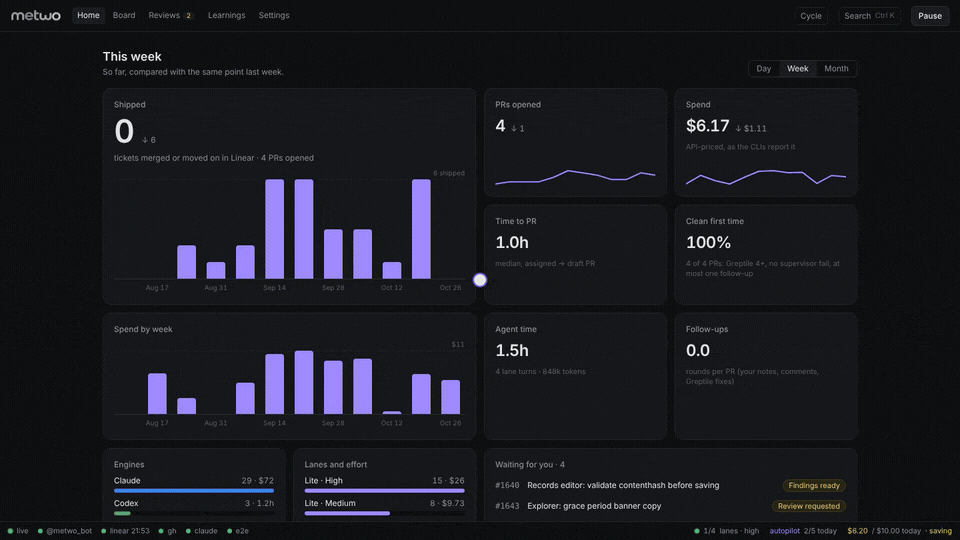

<p align="center">
  
</p>

<p align="center">
  <b>Your Linear tickets, worked by coding agents on your own Mac.<br>You review, metwo does the rest.</b>
</p>

<p align="center">
  Linear · Telegram · git worktrees · Claude Code / Codex / Cursor / OpenCode / Hermes · Playwright · GitHub
</p>

<p align="center">
  
</p>

---

A ticket gets assigned to you. metwo tells you on Telegram and puts it on the board. You pick a
lane (or autopilot picks it for small fixes), and a headless agent implements it in its own git
worktree, runs your tests, opens the app in a browser to check its own work and takes before and
after screenshots. A second agent from another vendor supervises it. Then it stops and waits for
you. You push, and metwo opens the draft PR with your `gh`, screenshots attached, tags Greptile
and follows the review until it merges. It also reviews the PRs your teammates ask you to look at.

Everything runs on your machine with your own CLIs, accounts and plans. Nothing is hosted.

```
Linear ──▶ Telegram / board ──▶ lane in .worktrees/<ID> ──▶ gates + browser + supervisor ──▶ you review
                                                                                              │ push
            merged ◀── review loop (Greptile, teammates, your notes) ◀── draft PR (gh) ◀──────┘
```

## What you get

| | |
| --- | --- |
| **Today** | Its own page: a brief from rules (no AI) of what needs you, PRs to review and what to pick from the cycle, three per group, each with its button. Below it, ask in plain words ("what first?", "which cycle tickets are UI only?", "take the easy ones"), and a list of what needs you, PRs to review and what to pick from the cycle, each with its button. Telegram: `/today`, `/ask` or just write the question. |
| **Triage** | An AI read of every cycle issue and your new tickets: size, kind, risk, and whether autopilot can take it. **Take the easy ones** assigns them and starts autopilot. |
| **Home** | What shipped, PRs opened, spend, time to PR, how often work came back clean; what waits for you; tips to spend less. |
| **Board** | Tickets by status with live lane logs. Start on `lite`, `full` or `max`, on any engine. |
| **Ticket page** | A seven-step stepper (assigned → implementing → review pass → gates + supervisor → your review → PR → merged) with each step's result, a card for what is happening now or what you do next, and every link in one row. Tabs for the summary, the diff, the PR description, the visual check and the Linear issue; on the right the activity, the PR comments and the live log. Tell the agent what to change in plain words, even while it runs. |
| **Reviews** | PRs you were asked to review. metwo checks them out, runs install, the gates and the app, drafts findings; you pick what to post. |
| **Autopilot** | Small tickets start by themselves, move to In Progress, and get a draft PR when every check passes. |
| **Budget** | Daily and monthly limits, alerts at 50/80/100 %, lower effort and plan or free engines as spend grows. |
| **Learnings** | Rules a curator proposes from PR feedback; approved ones go into every brief. |
| **Settings** | Autopilot, budget, lanes, engines and roles, integrations, and Stop everything. |
| **Telegram** | All of it from your phone. |
| **Desktop app** | Menu bar icon with how many tickets need you, notifications, starts the daemon at login. |

## Requirements

- macOS (Linux works for the daemon and web UI; the desktop app is macOS only)
- Node 22+, pnpm 10, git 2.38+, Google Chrome
- [Claude Code](https://docs.claude.com/en/docs/claude-code) signed in (`claude` on your PATH)
- [GitHub CLI](https://cli.github.com) signed in
- A Linear account, and a Telegram account for the bot
- Optional: Codex, Cursor, OpenCode or Hermes ([docs/engines.md](docs/engines.md)), Rust for the desktop app, `cloudflared` or Tailscale for phone access

## Run it locally

### 1. Install the tools

```sh
brew install node@22 pnpm gh git
npm i -g @anthropic-ai/claude-code
claude                                   # sign in once, then exit
gh auth login                            # HTTPS, browser sign-in
gh auth setup-git                        # lets metwo push and clone private docs repos
```

Browser checks need the Playwright MCP for Claude and a Chromium:

```sh
claude mcp add playwright -s user -- npx -y @playwright/mcp@latest
npx playwright install chromium
```

### 2. Get the code

```sh
git clone <this repo> metwo && cd metwo
pnpm install
cp .env.example .env
cp ticketflow.config.example.json ticketflow.config.json
```

### 3. Keys (`.env`)

| Variable | Where to get it |
| --- | --- |
| `LINEAR_API_KEY` | Linear → Settings → Security & access → Personal API keys → New key |
| `TELEGRAM_BOT_TOKEN` | Message [@BotFather](https://t.me/BotFather), `/newbot`, copy the token |
| `TELEGRAM_CHAT_ID` | Message [@userinfobot](https://t.me/userinfobot), copy your id. Then send your new bot any message once, so it can write to you. |
| `DASHBOARD_TOKEN` | Only for the phone tunnel: `openssl rand -hex 24` |

Keys stay in `.env`; it is gitignored.

### 4. Point it at your repo (`ticketflow.config.json`)

The example is the preset for ENS Labs' `apps-monorepo`. For any other repo you only need this
much; everything else has a default (see `apps/daemon/src/config.ts`):

```json
{
  "repo": {
    "path": "/Users/you/code/your-app",
    "baseBranch": "main",
    "commands": {
      "test": "pnpm test",
      "typecheck": "pnpm typecheck",
      "lint": "pnpm lint",
      "dev": "pnpm dev --port",
      "install": "pnpm install --frozen-lockfile"
    }
  },
  "linear": { "teamKey": "ENG", "watchStates": ["Todo", "In Progress"] }
}
```

- `commands.dev` gets a free port appended, so every lane runs its own dev server.
- `linear.teamKey` is the prefix of your issue ids (`ENG-123` → `ENG`).
- Your repo's own agent rules are picked up when they exist: `CLAUDE.md`, `AGENTS.md`,
  `STYLEGUIDE.md`, `REVIEW.md`, `CONTRIBUTING.md`, `.greptile/`, `.cursorrules`,
  `.github/copilot-instructions.md`.

### 5. Start it

```sh
pnpm --filter @ticketflow/web build
pnpm daemon                              # http://localhost:4747
```

Your bot says hello in Telegram and the board fills with the tickets assigned to you. The
status bar at the bottom of the window should be all green (E2E stays grey until you set it up).

For the desktop app instead (recommended for daily use):

```sh
curl https://sh.rustup.rs -sSf | sh      # once
pnpm app:build
open apps/desktop/src-tauri/target/release/bundle/macos
```

Drag **metwo.app** to Applications and add it to Login Items. It starts the daemon, puts the
**m** in the menu bar and keeps notifying with the window closed.

`pnpm dev:daemon` reloads on code changes while you work on metwo itself; a reload parks the
running lanes, so do not use it for real work.

## Team knowledge

Lanes, reviews and the curator read your team's docs before touching code. Point metwo at any
number of folders on your Mac, or git repos it keeps a copy of:

```json
"knowledge": {
  "sources": [
    { "name": "handbook", "path": "~/code/eng-handbook", "index": "INDEX.md",
      "alwaysRead": ["standards/typescript.md"],
      "byKeyword": { "payment": ["domains/payments.md"] },
      "review": ["review/checklist.md"] },
    { "name": "design-system", "git": "https://github.com/acme/design-docs.git", "branch": "main",
      "index": "README.md", "note": "tokens and components" }
  ],
  "syncHours": 6
}
```

- `index` is read in full first, every run. `alwaysRead` always, `byKeyword` when the word is
  in the ticket. `review` pages become review lenses for the review pass and PR reviews.
- Git sources are cloned into `data/knowledge/<name>` with your git credentials and pulled
  every `syncHours`.
- `wiki` (in the ENS preset) is the same thing with `INDEX.md` as the index, kept for existing
  setups. Use either or both.

## Browser checks and local services

Lanes drive your app on their own port with Playwright. If it needs local services (a chain
fork, mocks, a seeded database), tell metwo how to check and start them:

```json
"e2e": {
  "ports": { "api": 8080, "db": 5432 },
  "up": "docker compose up -d",
  "notes": "Sign in with the seeded user test@acme.dev / test1234."
}
```

Settings → Status shows them, and the brief tells each lane. Repos with an `e2e:infra:up`
script (apps-monorepo) get the ENS stack preset without any config.

## Daily use

- **Start a ticket**: board, ticket page, or the Telegram buttons. `lite` and `full` are the
  same runner with different models; `max` is full at max effort, only when you ask.
- **Needs input**: the lane wrote a question. Answer on the board or reply in Telegram.
- **Review ready**: read the diff and screenshots. **Tell the agent what to change** sends your
  words (and screenshots) to the same session. **Push** opens the draft PR.
- **After the PR**: Greptile findings arrive with **Fix them**. Teammates' comments are listed one
  by one on the ticket page: tick the ones the lane should address (with a note on how), **Reply**
  to one yourself (or let it draft the reply), or **Ignore** an "lgtm". metwo replies in the threads
  it addressed after the next push.
- **QA on preview**: once the PR has a preview deploy (Cloudflare's comment), **Test on preview**
  checks the ticket's criteria and the PR's testing steps on the deployed app at desktop and
  mobile, and you choose to post it as a comment and/or tick the description's checklists. When
  the PR gets the `QA Requested` label (`github.qa.label`), Telegram offers it;
  `github.qa.auto: true` runs it by itself. Wallet steps stay "not checked". **Ready for review** runs `gh pr ready` and requests
  GitHub's suggested reviewers. Opening, readying, merging or closing on GitHub shows up here.
- **Stop / Resume**: Stop kills the lane and its dev servers and writes `RESUME.md`; Resume
  continues the same session. **Stop everything** (Settings → Status, `/stopall`) does it for all.
- **Pause after this step**: lets the current step finish and parks the ticket before the next
  one (the review pass, the gates and supervisor, or another supervisor round). Resume carries on.
- **Estimates**: before you start, each lane shows the time and cost range of your own past runs on
  similar tickets (same triage size and kind, else a shared label), and how often they came back
  clean. Worked out from the ticket history on your machine, no AI. They need 5 finished runs
  like it; until then there is no estimate. While a lane runs, the page and the card show elapsed
  time against it and the spend so far (`≈` when the time since the last reported turn is
  estimated at your usual $/min; Codex and Cursor report no cost, so only time).
- **Ask before starting**: with an estimate over 30 min or $3, a sensitive label (security,
  protocol, auth, payment…) or a budget that may not fit, Start asks first. The checkbox in
  "Before you start" turns it off for your browser.
- **Instructions while it runs**: "Tell the agent" queues your instruction and sends it to the
  same session as soon as the run comes back. Cancel it from the same box.
- **Update from main**: every 15 minutes metwo checks which branches are behind main and whether
  merging would conflict. Update merges main in (no force push), re-runs the gates and pushes.
- **Board filters**: labels in Linear's own colors, quick fixes, autopilot and has-PR; the filter
  lives in the URL so you can bookmark a view.
- **Open in Claude** (ticket page, ⌘K): Claude Code in your terminal, in the ticket's worktree, to
  ask about the work. It resumes the lane's own session when nothing is running on it; otherwise a
  fresh read-only session reads the brief, the summary and the diff first. Warp, iTerm, Ghostty or
  Terminal (`pipeline.terminal`, `auto` picks the first installed).
- **Push** shows each step on the card. Commits pushed on GitHub (its Update branch button, a
  teammate) are merged in first so the push is not rejected; a conflict stops with the files and
  what to do.
- **⌘K** jumps to any ticket or action. **Cycle** lists unassigned issues in the current cycle.

### Lifecycle

```
assigned ─▶ queued ─▶ running ─┬─▶ needs_input ─(you answer)─▶ running
                               ├─▶ review_ready ─(push)─▶ pr_draft ─(merged)─▶ done
                               ├─▶ no_change
                               ├─▶ stopped ─(resume)─▶ running
                               └─▶ failed
```

While running, the implementer reads `.worktrees/<ID>-flow/brief.md` (the ticket, its Linear
discussion and images, the team knowledge, the repo rules, team learnings) and commits locally.
Then a review pass, then metwo re-runs typecheck, lint and tests itself and a different engine
supervises the work against the ticket. Concerns go back to the implementer up to
`roles.supervisorRounds` times.

## The PR it writes

Your team's structure, filled from what the lane actually did: Summary (with the ticket link),
Changes (before, after, key decisions), Review Guide, Screenshots / Video, Verification,
**Regression** (what was modified, how each change was checked in its callers and tests, and
what else could be affected), AI Assistance, Human Testing Required, Risks & Release Notes, and
`Ref: <ID>`. Commits carry no AI attribution.

After a new visual check (or `/desc WEB-123` after any fix), **Post to PR** can update the
description instead of adding a comment: an agent proposes line changes to the Verification and
Regression sections (ticking what the new check proved, updating known gaps), you keep or drop
each one, and metwo applies them to the live description, swaps the retaken screenshots, adds a
dated line to `## Updates` and, if you want, a short comment so reviewers get notified. It never
touches Human Testing Required or Human verified, and skips a line someone edited meanwhile.

Screenshots are attached the way you would: metwo's own Chrome profile (`data/github-profile`)
drops them into the PR comment box and reads the links back without posting. Sign it in once
from Settings → Integrations or `/ghlogin`. Signed out, images go to a secret gist.

## Today and the assistant

The assistant works only through the app's own actions (take, start, review, visual check, QA on
preview, update from main, address comments, resume, triage). It answers from your tickets, PRs,
reviews and the cycle, shows the ones it means as cards, and proposes a plan you tick and run. It
never pushes, merges, marks a PR ready or posts anything. Triage runs when you press Triage, or by itself a few times a day with Settings → General →
*Triage the cycle by itself* (`triage.auto`); only new or edited issues are read, and its cost
counts in the budget.

## Autopilot

Off by default; Settings → General or `/autopilot on`. Small tickets (a quick UI fix, a
low-risk label, estimate 2 or less, never a `classifier.neverAuto` label) start by themselves
and move to In Progress in Linear. If the gates pass, the supervisor says pass, the visual check
is verified and nothing is left uncommitted, metwo opens the draft PR itself. Otherwise it stops
at review ready and Telegram says why. It never marks a PR ready for review.
`autopilot.maxPerDay` (5) caps it; `autopilot.autoPush: false` makes every ticket wait for you.

## Budget and engines

Spend is what the CLIs report at API prices. Claude reports it even on a Max plan, so it works
as a usage meter; Codex and Cursor report nothing because they run on your subscription.

- **Limits**: Settings → Budget or `/budget day 15`, `/budget month 250`, `/budget off`.
  Telegram warns at 50, 80 and 100 %.
- **Regulation** (on by default): from 60 % effort is capped at medium and lite skips the review
  pass; from 90 % lite lanes move to your plan engine on low effort; at 100 % every new lane does.
- **Plan first**: send lite lanes (or all) to Codex, Cursor or OpenCode from the start, so the
  plans you already pay for, or free models, do the work before Claude spends budget.
- A ticket you start on a specific engine keeps it.

Engines and roles (implementer, reviewer, supervisor, visual check, curator) are in Settings →
Engines. Setup for each CLI: [docs/engines.md](docs/engines.md).

## Telegram

`/help` lists everything. The ones you will use most:

| | |
| --- | --- |
| `/start WEB-123 lite\|full\|max [engine]` | start a ticket |
| `/push WEB-123` | push and open the draft PR |
| `/tell WEB-123 …`, or just write with the id | instruct the lane (screenshots welcome) |
| `/stop WEB-123`, `/resume WEB-123`, `/stopall` | stop and pick up |
| `/update WEB-123` | merge main in, push if green |
| `/review <PR link>`, or paste a PR link | review a teammate's PR |
| `/preview WEB-123` | QA round on the PR's preview deploy (you post it) |
| `/today`, `/ask …` (or just write a question) | what needs you, and plain-words questions with a plan you approve |
| `/desc WEB-123` | tick the PR description checklists from the latest work (you approve) |
| `/ready`, `/qa`, `/done` | PR out of draft, Linear to QA or Done |
| `/autopilot on\|off`, `/budget`, `/effort`, `/lanes 4` | settings |

## From your phone

- **Tailscale** (private): open `http://<mac-name>:4747`.
- **Cloudflare quick tunnel**: `brew install cloudflared`, set `DASHBOARD_TOKEN` in `.env` and
  `"server": { "tunnel": true }`. The link (with the token) arrives in Telegram; `/tunnel`
  resends it. metwo refuses to open a tunnel without a token.

## Where things land

```
<repo>/.worktrees/ENG-123/          the ticket's worktree, branch linear/ENG-123 (repo.branchPattern)
<repo>/.worktrees/ENG-123-flow/     brief.md, PR-BODY.md, VISUAL.json, RESUME.md, shots/, videos/, logs/
<repo>/.worktrees/PR-1640/          a PR you review, checked out detached
data/                               state.json, settings, pending.md, logs, knowledge/, browser profile (gitignored)
learnings/rules.md                  approved team learnings (commit it)
```

Add `.worktrees/` to your repo's `.gitignore`. Remove a worktree after merge with
`git worktree remove .worktrees/ENG-123`.

## Troubleshooting

| Symptom | Fix |
| --- | --- |
| `claude CLI not found` in the app | The app reads your login shell PATH; check `which claude` in a terminal and restart the app. |
| Telegram is silent | Send the bot a message first; `TELEGRAM_CHAT_ID` is your id, not the bot's. |
| Linear moves fail | Your workflow state names differ: set `linear.states` (`inProgress`, `qa`, `done`). |
| No tickets show up | `linear.teamKey` and `linear.watchStates` must match your team. |
| Screenshots not attached | Settings → Integrations → Sign in to GitHub, or `/ghlogin`. |
| A lane looks stuck | It warns after `pipeline.stuckMinutes`; long builds are quiet too. Stop keeps its work. |
| An engine shows red | Run its login command ([docs/engines.md](docs/engines.md)), then **Test** in Settings → Engines. |

## Safety

- Lanes run with full permissions (`claude --permission-mode bypassPermissions`, Codex
  `danger-full-access`, Cursor `--force`, OpenCode with every permission allowed): they install,
  run dev servers and drive a browser. Run metwo on a machine and user you are fine giving that.
- What metwo writes for you: commits in worktrees; pushes and draft PRs when you push (or
  autopilot's auto push for small tickets that passed every check); the Greptile tag; update
  comments and thread replies on your PRs; reviews you choose to post; signed comments on Linear
  issues (`linear.comments`, `enabled: false` turns them off); In Progress on start with
  autopilot, QA and Done only when you press them.

## Layout

```
apps/daemon      Node 22 + TypeScript: Linear poller, Telegram bot, runner, PR sync, reviews, HTTP/SSE API
apps/web         Vite + React 19 + Tailwind 4: Home, Board, Reviews, Learnings, Settings
apps/desktop     Tauri: runs the daemon, menu bar, notifications
packages/shared  types and small helpers both sides use
docs/engines.md  other engines, roles and plan first
```

The package and folder names say `ticketflow`; everything you see says metwo.
