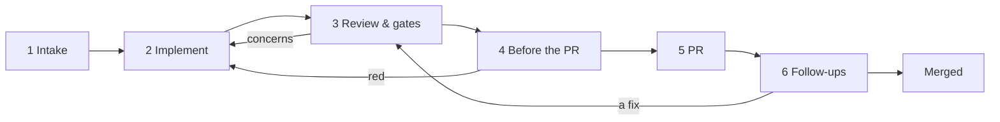

# How mevo works, phase by phase

What happens to a ticket from Linear to merge. For each phase: when it runs, who does the work,
what it reads and writes, and what you see. Where each value is set: [pipeline.md](pipeline.md).
Plans for later: [ideas/visual-steps.md](ideas/visual-steps.md), [ideas/custom-phases.md](ideas/custom-phases.md).

Two kinds of work happen in it:

- **Model calls**: implement, review pass, supervisor, visual check, readiness, quick fixes. They
  run a CLI (Claude Code, Codex, Cursor, OpenCode, Hermes) in the ticket's worktree.
- **mevo's own work**: git, the gates, e2e, GitHub, Linear, Slack. No model, no tokens.

Every ticket has a **worktree** (`<repo>/.worktrees/<ID>`) on its own branch (`linear/<ID>`),
and a **flow folder** next to it (`<ID>-flow`). The flow folder holds the brief, logs,
screenshots and the files a phase hands to the next; it is never committed.

## 1. Intake

**When**: every 15 seconds mevo reads your tracker for issues assigned to you: Linear (in the watched states) or GitHub Issues (open ones in the repo, see [any-repo.md](any-repo.md)).

**What happens**:

- **The classifier** sizes each new ticket: a **lite** lane (small, a quick UI fix) or a **full**
  lane (bugs, security, high priority, big estimates). It also decides whether autopilot may start
  it. It uses labels, estimate and wording; no model.
- **The readiness check** (a cheap model, no tools) reads the ticket and its Linear comments. It
  answers ready, clarify or hold, with a confidence, the scope it understood, decisions already
  made in the comments, and open questions.
- **Triage** (optional) sizes the cycle's issues a few times a day.
- **Autopilot** (off by default) starts small tickets that are ready, up to a daily cap. Anything
  else waits for you to press Start (lite, full or max).

**You see**: the ticket on the board as *assigned*, with the readiness chip.

**Settings**: Pipeline → Intake.

## 2. Implement

**When**: you press Start, autopilot starts a ticket, or a queued one gets a free lane.

**What happens**:

1. mevo creates the worktree from the latest base branch and gives it a port.
2. It gathers context: Linear comments and their images, Slack threads linked in the ticket,
   Figma frames (downloaded as the design reference), and past review feedback on similar work.
3. It writes the **brief** (`brief.md`). The brief has these blocks:
   - the ticket;
   - the context above;
   - acceptance criteria to derive;
   - the size budget;
   - team knowledge, MCP, engineering principles and approved learnings;
   - the repo's own rules (CLAUDE.md, STYLEGUIDE.md, .greptile…);
   - the repo commands;
   - browser verification, screenshots, Storybook and video;
   - the PR body template;
   - the hard rules.
4. The **implementer** (Claude by default, or another engine per lane) reads the brief and works.
   It makes local commits only (no push, no network writes), runs test, typecheck and lint until
   they pass, and checks UI changes in a browser.

**Writes**:

- **Commits** on the branch.
- **`ARM-SUMMARY.md`**: acceptance criteria, what changed, gate output, regression check, risks,
  confidence.
- **`PR-BODY.md`**: the PR description.
- **`VISUAL.json`** and **`shots/`**, **`videos/`**: the visual verdict and its evidence.
- **`ARM-BLOCKED.md`** instead, when it needs a decision. The ticket goes to *needs input*, with
  the options as buttons. Your answer resumes the same session.

**You see**: the live log on the ticket, then *review ready* with the commits, the size and the
verdicts. *No change* when the lane found nothing to do.

**Settings**: Pipeline → Implement (engine per lane, effort, lanes at once, size target,
principles, context blocks, instructions).

## 3. Review & gates

**When**: right after the implementer finishes, before you see the work.

**What happens**:

1. **Review pass** (a second engine or the same one, fresh). It reads the diff with review lenses
   (principles, knowledge, repo rules, past feedback) and fixes what it finds with small commits.
   It adds a security lens when the diff touches signing, transactions, approvals, auth, storage
   or raw HTML. Skipped for lite tickets when the budget is saving.
2. **Gates**: mevo re-runs typecheck, lint and tests itself. It doesn't take the lane's word.
3. **Supervisor**, only when the gates pass. By default it is another vendor than the
   implementer. It reads the brief, the diff, the summary, the PR body and the screenshots, and
   judges each acceptance criterion with evidence. Every P1 and P2 finding must come with proof
   (a failing test, a repro, a command and its output). It changes nothing.
4. Red gates or a proven P1/P2 send the work back to the implementer with the findings, up to the
   round limit. Unmet criteria and P3 notes go to you with the work instead: another paid round
   rarely closes evidence gaps.

**Writes**: `SUPERVISE.json`. The review pass appends "## Review pass" to ARM-SUMMARY.md.

**You see**: the Supervisor card (verdict, criteria with evidence, findings with proof) and the
review pass in the journal.

**Settings**: Pipeline → Review & gates.

## Visual check (inside implement today, or on demand)

The lane plans the screenshots from the acceptance criteria while it implements: one per
criterion it can see or per state that looks different, up to a limit (8 by default), mobile
only where the layout changes, before shots only for states whose look changed. A video only
when a still can't show the change, planned as steps and sped up 1.5x. It writes VISUAL.json:
verified, partial, not verified or not applicable, one check per state. Only the shots a check
names (with their before shots) reach the PR, in the order of the checks, plus one video. **Run visual check** on the ticket shoots again without changing code and
compares against the previous set and the Figma frames.

**Steps mode** (paused for now: mevo always uses lane mode, see [visual-steps.md](visual-steps.md)): the lane
writes the test as steps (`VISUAL-PLAN.json`) instead of shooting. mevo runs them headless on the
app from the worktree with the test wallet, takes the screenshots the steps ask for (and the
before shots on a checkout of the base branch), and records one video cut to the steps and sped
up. A short session on the visual check's engine then judges the shots in VISUAL.json. If a step
fails, that session takes the screenshots itself instead, as without steps. The Visual tab lists
the steps with what happened to each, and the same steps start Test by hand. Details: [ideas/visual-steps.md](ideas/visual-steps.md).

**Settings**: Pipeline → Review & gates → Visual check.

## 4. Before the PR

**When**: when a lane finishes, and before every push.

**What happens**: **local checks**, mevo's own run of what CI would run: the gates (reused when
the supervisor just ran them green on the same commit), then the e2e specs related to the change
on the local e2e stack (Anvil fork, bundler, mocks). Once the PR is open, e2e is left to GitHub's
CI unless you turn it on here. mevo also counts the **size** (lines changed, without lockfiles and
snapshots).

A red result keeps the PR closed. The lane can fix it ("Fix with the lane", with the logs and the
commands to re-run), or you press **Push anyway**. Over the size maximum, the PR still opens as a
draft, but Ready for review is held.

**You see**: the Local checks card with each step, its log, and the lane's explanation when it
can't make one pass.

**Settings**: Pipeline → Before the PR.

## 5. PR

**When**: the first time a lane finishes with checks green, mevo pushes and opens a **draft** PR
by itself (Open the draft PR when a lane finishes). Later rounds wait for your Push.

**What happens**:

- The PR opens with the lane's `PR-BODY.md` and mevo's additions: Size, the screenshots and
  videos (uploaded through GitHub's own uploader), the stories for the changed files, the preview
  link. The body closes with `Fixes <ID>`.
- Greptile is asked to review.
- Linear gets a comment (by default when the PR opens; which moments post is configurable).
- **Ready for review** is your button, never mevo's. It is held while the size is over the
  maximum or the Greptile score is under the minimum (you can mark it ready anyway). When it is
  ready, mevo requests GitHub's suggested reviewers, links the PR on the Linear issue, and
  announces it on Slack when that is on.

**You see**: the ticket in *PR draft*, with CI, Greptile, reviewers and the preview deploy.

**Settings**: Pipeline → PR.

## 6. Follow-ups

**When**: every 3 minutes mevo syncs open PRs: comments, reviews, CI, Greptile, new commits.

**What happens**:

- **Review comments**: Analyze first (a read-only pass says for each one whether it holds), then
  fix them with the lane or a **quick fix** (fresh session, cheap model, low effort, no e2e: you
  check it by hand). After the push, mevo replies "Addressed in `<sha>`" in each thread,
  re-requests the review, and resolves the threads if you turned that on.
- **Greptile findings**: the same. Quick fix by default when every finding is P2 or P3.
- **Failing CI**: the failing jobs' logs and whether main fails the same way, sent to the lane.
- **Main moved on**: how far behind each branch is. *Update from main* merges it (by itself when
  conflict free, if on); conflicts get a lane or a manual merge in your editor.
- **Commits made on GitHub** (Update branch, a teammate): fast-forwarded into the worktree by
  itself when possible, otherwise *Pull from GitHub*.
- **Unpushed local fixes** show on the card with a Push button, so nothing fixed locally gets lost.

Each fix round goes back through Review & gates and Before the PR.

**Settings**: Pipeline → Follow-ups.

## Requests

**When**: every two minutes, and on **check now** in the column.

**What happens**: mevo reads what is new about your open tickets:

- comments on the Linear issue;
- your teammates' comments on the PR (not bots, not Greptile);
- Slack mentions and DMs that link the ticket, its Linear issue or its PR.

A cheap read-only call sorts each one: change, bug, question, approval or nothing. A change or a
bug becomes a **request** on the board's **Requests** column, after Assigned. The card shows:

- who asked, where, and the quote;
- mevo's read: makes sense, check it, or out of scope, with why;
- the instruction the lane would get, which you can edit.

The same ask from two places is one card with both sources. The first time mevo looks at a
ticket, its older comments are skipped: they are already in the brief.

**Nothing runs until you press a button**:

- **Send to lane**, or **Quick fix** for a cheap fresh session. PR comments alone go through
  the PR comment flow; anything else is sent as your instruction, with the quotes and links.
- **Send all** sends every open request on the ticket in one run.
- **Reply** and **Decline** answer in the thread it came from, as you.
- **New ticket** makes a Linear issue for an out-of-scope ask and drafts the reply.
- **Done** closes it without answering.

After the push, a sent request shows "addressed in `sha`" with a reply draft. **Post reply**
answers in the Linear thread or the Slack thread. PR review threads already get their "Addressed
in" from the comment flow. The ticket card shows the count, and Today links to the column.

**At night**: with Night Shift on, a new Linear comment is also read like a Slack message.
Settings → Integrations → Night Shift → **Linear comments**:

- **Drafts only** (the default): the answers wait in the morning handoff.
- **Post by itself**: facts and a one-time "noted" go out under the comment, in its thread,
  from your account, always starting with "🤖 mevo, your assistant".
- **Off**.

## Test by hand

**When**: you press Test by hand on a ticket.

**What happens**: a cheap model reads the ticket and the diff and writes 3 to 8 steps, each with
how to do it, what you should see, and how mevo can tell it is done:

- the URL;
- text or an element on the page;
- a wallet call or a transaction;
- a copy to the clipboard;
- or manual.

You run them in one of these places:

- **Your Chrome**: your own Chrome and MetaMask. The app runs from the worktree behind a small
  proxy that adds the steps panel. mevo takes you to each step's page and ticks steps when it sees
  them.
- **Test wallet**: a Chromium window on the app from the worktree, on the local fork, with the
  e2e headless wallet in every tab. mevo connects it the way the e2e fixtures do: it opens the
  connect dialog, picks "Headless Web3 Provider" and skips the backend sign-in prompt. It also
  clears the leftover contract code on account 0 so UI registrations don't revert. Signatures
  are approved by themselves; transactions wait for Approve in the panel. When the steps come
  from the visual plan, **Run the steps for me** plays them while you watch.
- **Preview**: the PR's preview deploy, no wallet.
- **A phone**: Chrome on an Android phone over adb.

Each step leaves a screenshot, and the run a video, on the ticket.

## Replay

**When**: you press Replay now on a ticket that already ran (done, in draft or waiting for review).

**What happens**: mevo makes a copy, `REPLAY-<n>`, and runs the whole first pass again, with
**today's settings**. It starts from the commit of the base branch where the original started.
It reads the same ticket, and only the Linear comments written before the original started. It
has its own branch (`replay/<ID>-<n>`) and worktree.

It goes through implement, review pass, gates, supervisor, visual and local checks, and stops at
review ready. It never pushes, opens a PR, comments on Linear or GitHub, or moves the issue.
Replays don't show on the board, in Today, in the digest or in Night Shift answers.

**You see**: a Replays card on the original, with a table of the first pass of each run next to
the original's:

- cost, tokens and time;
- turns and supervisor rounds;
- lines, files and whether they are the same files as the original's;
- supervisor, local checks and visual verdicts;
- screenshots and videos;
- the settings each run used.

Delete replay removes its worktree, branch and record.

Use it to try a setting on real work: change it in Settings, replay two or three finished
tickets, and compare. Runs differ even with the same settings, so one replay alone proves little.

## Merged

When the PR merges, the ticket is *done* (the PR's `Fixes <ID>` closes the Linear issue). Three days later the ticket is
archived: slim on the board, full record in `data/archive`.

## Where it can stop

| Status | Why | What to do |
|---|---|---|
| needs input | The lane wrote ARM-BLOCKED.md with a question | Answer it; the same session resumes |
| no change | The lane found nothing to change | Close it, or start again with an instruction |
| stopped | You stopped it, or mevo restarted mid-run | Resume (same or another engine), or start fresh |
| failed | An error outside the lane's work (git, an engine missing) | The journal says what; fix and resume |
| local checks red | A gate or e2e fails before the push | Fix with the lane, or Push anyway |
| ready held | Over the size maximum or under the Greptile minimum | Split it, raise the limit, or mark it ready anyway |
