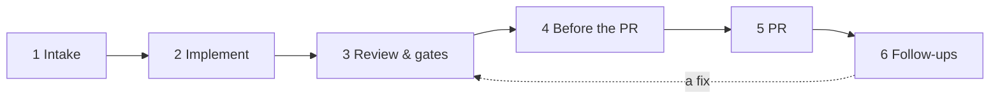

# The pipeline

How a Linear ticket becomes a PR in mevo, stage by stage, and where each part is configured.
Settings → Pipeline shows the same six stages, in the same order, with the values in effect now.
What each phase does, step by step: [how-it-works.md](how-it-works.md).



| Stage | What happens | Ends when |
|---|---|---|
| 1. Intake | The ticket shows up, is sized (lite or full lane), its readiness is checked, and autopilot starts it or it waits for you. | A lane starts. |
| 2. Implement | A lane works in its own worktree from a brief: the ticket, Figma, the wiki, knowledge sources, engineering principles, the size target. | The lane says it's done. |
| 3. Review & gates | A review pass (another engine) reads the work, mevo re-runs typecheck, lint and tests, and the supervisor checks the work against the ticket. Concerns go back to the lane, up to the round limit. | Review ready. |
| 4. Before the PR | Local checks: the gates plus the e2e specs related to the change. Red holds the push. The size is counted against the maximum. | Checks pass, or you push anyway. |
| 5. PR | The draft PR opens with screenshots, Greptile is asked to review, and on Ready for review reviewers are requested. mevo never marks a PR ready by itself. | You mark it ready. |
| 6. Follow-ups | Review comments, Greptile findings and failing CI go back to a lane or a quick fix, threads get replies, main and GitHub commits come in. | Merged. |

## Where a value comes from

Each value is looked up in this order, the first one set wins:

1. **Settings** in the app (saved in `data/state.json`). A changed value shows *changed · reset*;
   reset goes back to the config file.
2. **`stages`** in `ticketflow.config.json`.
3. The **flat keys** in `ticketflow.config.json` (`roles`, `pipeline`, `quality`…), as before.
4. The defaults in `apps/daemon/src/config.ts`.

You don't need to move to `stages`: the flat keys keep working, and a file can mix both. A key in
`stages` that mevo doesn't know stops the daemon with its name, so typos don't pass silently.

## The stages block

Every key is optional. This one is the defaults, plus a 400-line max and the gate commands:

```json
{
  "repo": { "path": "/Users/you/code/apps-monorepo" },
  "linear": { "teamKey": "WEB" },
  "stages": {
    "intake": {
      "watch": ["Todo", "In Progress"],
      "autopilot": { "enabled": false, "autoPush": false, "maxPerDay": 5 },
      "triage": { "auto": false },
      "readiness": { "auto": true, "engine": "auto", "minConfidence": 70 }
    },
    "implement": {
      "engine": { "lite": "claude", "full": "claude" },
      "models": { "lite": "opus", "full": "opus" },
      "effort": "medium",
      "maxParallel": 2,
      "targetLines": null
    },
    "review": {
      "pass": true,
      "engine": "claude",
      "model": "opus",
      "securityLens": true,
      "supervisor": { "engine": "opposite", "rounds": 2 },
      "visual": "claude",
      "gates": { "typecheck": "pnpm typecheck", "lint": "pnpm lint", "test": "pnpm test" }
    },
    "beforePr": {
      "localChecks": { "enabled": true, "e2e": "related", "e2eMinutes": 45, "e2eAfterPr": false },
      "maxLines": 400
    },
    "pr": {
      "draftOnFinish": true,
      "screenshots": "browser",
      "greptile": { "enabled": true, "minScore": null },
      "reviewers": { "auto": true, "max": 2 }
    },
    "followUps": {
      "quick": "claude:sonnet",
      "afterFix": { "reply": true, "resolve": false, "rerequest": true },
      "autoUpdateFromMain": false,
      "autoPullPr": true
    }
  }
}
```

Engines are written `claude`, `codex`, `cursor`, `opencode` or `hermes`, optionally with a model:
`claude:sonnet`, `codex:gpt-5`. An engine has to be turned on in Settings → Engines & budget
(or `engines` in the file); a step on an engine that is off falls back to Claude. Claude's models
for the lanes are `implement.models` and `review.model`; other engines use their model from
`engines`.

## Each AI step: model, effort, context and instructions

Five steps call a model: **implement**, **review** (the review pass), **supervisor**, **visual**
(the visual check) and **quick** (quick fixes). Each one is set the same way:

- **Model**: the engine, optionally with a model: `claude`, `claude:sonnet`, `codex:gpt-5`.
  `claude` alone uses the model from `implement.models` or `review.model`.
- **Effort**: `low`, `medium`, `high`, or `null` for the global effort. Quick fixes default to
  `low`. Implement always uses the global effort (the budget can lower it, and Start max raises it).
- **Context**: blocks of the prompt that can be turned off. All are on by default.
- **Instructions**: text added to that step's prompt, e.g. "check every new string has an i18n key".

In Settings → Pipeline, each step has an *Effort, context and instructions* row with a
**Preview**: pick a ticket and see the exact prompt the step would get with the current settings,
block by block with its size. Nothing runs. Linear comments are read; images, Slack threads and
Figma frames are only fetched when the lane starts, so they show as notes.

| Step | Context blocks |
|---|---|
| implement | `linear`, `slack`, `figma`, `feedback`, `readiness`, `knowledge`, `mcp`, `principles`, `learnings`, `repoRules`, `browser`, `storybook`, `video` |
| review | `knowledge`, `lenses`, `repoRules`, `feedback` |
| supervisor | `repoRules`, `figma`, `principles` |
| visual | `figma` |
| quick | none |

What each block is: `linear` the issue's comments and images · `slack` linked Slack threads ·
`figma` linked frames as the design reference · `feedback` what reviewers said before on similar
work · `readiness` the readiness check's read · `knowledge` the wiki and knowledge sources ·
`mcp` the team MCP servers · `principles` pstack · `learnings` rules you approved · `repoRules`
CLAUDE.md, STYLEGUIDE.md, .greptile and the other agent files · `browser` driving the app with
Playwright · `storybook` stories and their screenshots · `video` a short clip · `lenses`
principles and knowledge as review lenses.

The task, the output files mevo reads (ARM-SUMMARY.md, VISUAL.json, PR-BODY.md, SUPERVISE.json)
and the safety rules are always in the prompt.

```json
{
  "stages": {
    "implement": { "context": { "video": false, "storybook": false }, "instructions": "Use thorin components." },
    "review": {
      "engine": "claude:sonnet",
      "effort": "high",
      "context": { "feedback": false },
      "instructions": "Check i18n keys.",
      "supervisor": { "engine": "codex:gpt-5", "effort": "medium", "context": { "figma": false } }
    }
  }
}
```

Without `stages`, the same values live under the
flat key `steps`: `"steps": { "review": { "effort": "high", "context": { "feedback": false } } }`.

| `stages.` key | Flat key |
|---|---|
| `implement.context`, `implement.instructions` | `steps.implement.*` |
| `review.effort`, `review.context`, `review.instructions` | `steps.review.*` |
| `review.supervisor.effort`, `.context`, `.instructions` | `steps.supervisor.*` |
| `review.visualCheck` | `steps.visual` |
| `followUps.quickFix` | `steps.quick` |

## Every key

**In Settings** says where to change it in the app. *File only* values show in Settings →
Pipeline as read-only rows.

### 1. Intake

| `stages.` key | Flat key | In Settings | What it does |
|---|---|---|---|
| `intake.watch` | `linear.watchStates` | file only | Linear states whose issues assigned to you come onto the board. |
| `intake.autopilot` | `autopilot` | Intake → Autopilot, Tickets per day; PR → Autopilot opens it too | `enabled`: small tickets start by themselves. `maxPerDay`: the daily cap. `autoPush`: an autopilot ticket that passes everything also gets its draft PR. |
| `intake.triage` | `triage` | Intake → Triage the cycle by itself | `auto`: AI sizes new and edited cycle issues a few times a day. |
| `intake.readiness` | `readiness` | Intake → Check readiness, Readiness engine, Autopilot needs | `auto`, `engine` (`auto`, `off` or an engine), `minConfidence` (0-100) autopilot needs. |
| `intake.classifier` | `classifier` | file only | `fullLaneLabels`, `neverAuto`, `autoLabels`, `startLabels`, `uiHints`: how a ticket is sized and whether it may start by itself. |

### 2. Implement

| `stages.` key | Flat key | In Settings | What it does |
|---|---|---|---|
| `implement.engine.lite` / `.full` | `roles.implementer` | Implement → Implementer | The engine for each lane size. |
| `implement.models.lite` / `.full` | `models.lite.model` / `models.full.model` | file only | Claude's model when Claude implements. |
| `implement.effort` | `pipeline.effort` | Implement → Effort | `low`, `medium`, `high`, for lanes and the review pass. The budget can lower it. |
| `implement.maxParallel` | `pipeline.maxParallel` | Implement → Lanes at once | Lanes at the same time. |
| `implement.targetLines` | `quality.targetLines` | Implement → Aim for | Lines the lane aims for; bigger work is split into follow-ups. `null`: no target. |
| `implement.principles` | `principles` | Implement → Engineering principles | pstack at a pinned commit (`enabled`, `ref`, the file lists). |
| `implement.knowledge` | `knowledge` | file only | Knowledge sources, sync hours, team MCP servers. |
| `implement.wiki` | `wiki` | file only | Your docs clone and what to read from it. |
| `implement.figma` | `figma` | Integrations → Figma | Figma frames in the ticket become the design reference. |

### 3. Review & gates

| `stages.` key | Flat key | In Settings | What it does |
|---|---|---|---|
| `review.pass` | `pipeline.reviewPass` | Review → Review pass | A second read of the finished work before the gates. |
| `review.engine` | `roles.reviewer` | Review → Reviewer | The review pass, and PRs you review. |
| `review.model` | `models.review.model` | file only | Claude's model for it. |
| `review.securityLens` | `quality.securityLens` | Review → Security lens | An extra security read when the diff touches signing, transactions, auth, storage or HTML. |
| `review.security` | `quality.security` | file only | The regexes on added lines that turn the lens on. |
| `review.gates.typecheck` / `.lint` / `.test` | `repo.commands.*` | file only | The gate commands, re-run by mevo after the lane. |
| `review.supervisor.engine` | `roles.supervisor` | Review → Supervisor | `opposite` (another vendor than the implementer), `off`, or an engine. |
| `review.supervisor.rounds` | `roles.supervisorRounds` | Review → Supervisor rounds | How many times concerns go back to the lane. |
| `review.visual` | `roles.visual` | Review → Visual check | The engine for Run visual check. |
| `review.shots` | `shots` | Review → Who takes the screenshots, Screenshots at most, Mobile shots, Before shots, Video, Story shots at most | `mode` (`lane`; `steps` is paused and read as `lane`), `max` (8), `mobile` (`layout`, `always`, `never`), `before` (`changed`, `bugs`, `never`), `video` (`interactions`, `off`), `speed` (1.5), `stories` (4). Lane mode: only the shots VISUAL.json names reach the PR. Steps mode: the shots of mevo's run. Plus one video. |

### 4. Before the PR

| `stages.` key | Flat key | In Settings | What it does |
|---|---|---|---|
| `beforePr.localChecks` | `localChecks` | Before the PR → Local checks, e2e specs, e2e once the PR is open | `enabled`; `e2e`: `related`, `all` or `off`; `e2eMinutes`; `e2eAfterPr`: keep running e2e here once the PR exists. |
| `beforePr.maxLines` | `quality.maxLines` | Before the PR → Most | Over it Ready for review is held and autopilot stops before the PR. |
| `beforePr.sizeIgnore` | `quality.sizeIgnore` | file only | Globs left out of the size (lockfiles, snapshots). |

### 5. PR

| `stages.` key | Flat key | In Settings | What it does |
|---|---|---|---|
| `pr.draftOnFinish` | `pipeline.draftOnFinish` | PR → Open the draft PR when a lane finishes | The first finish with no PR pushes and opens a draft. |
| `pr.pushMode` | `pipeline.pushMode` | file only | `ask`: later rounds wait for your Push. `auto`: every finished lane pushes. |
| `pr.screenshots` | `github.screenshots` | PR → Screenshots and videos | `browser`, `gist` or `none`. Switching to `browser` needs a restart. |
| `pr.greptile` | `github.greptile` | PR → Greptile | `enabled`, `trigger`, `bot`. |
| `pr.greptile.minScore` | `quality.minGreptile` | PR → Greptile at least | Score out of 5 that Ready for review needs. |
| `pr.reviewers` | `github.reviewers` | PR → Request reviewers | `auto`, `max`: GitHub's suggested reviewers on Ready for review. |
| `pr.linearComments` | `linear.comments` | file only | Which moments post on the Linear issue, and the signature. |

### 6. Follow-ups

| `stages.` key | Flat key | In Settings | What it does |
|---|---|---|---|
| `followUps.quick` | `quality.quick` | Follow-ups → Quick fix engine | Engine for Quick fix: fresh session, low effort, no e2e. |
| `followUps.afterFix` | `afterFix` | Follow-ups → Reply, Resolve, Re-review | What happens on GitHub after a push that answers review comments. |
| `followUps.autoUpdateFromMain` | `pipeline.autoUpdateFromMain` | Follow-ups → Update from main by itself | Merge main into open drafts that are behind and conflict free. |
| `followUps.autoPullPr` | `pipeline.autoPullPr` | Follow-ups → Pull commits made on GitHub | Fast-forward commits made on GitHub into the worktree. |
| `followUps.qa` | `github.qa` | file only | The QA round on the preview deploy when the PR gets the label. |

## Not part of the pipeline

These stay as flat keys and in their own Settings tabs: `engines` and `budget` (Engines & budget),
`slack`, `figma` (Integrations), `mascot` and `daemon` (App), `server`, `security`, `e2e`
(the local services), `chat` (questions in the ticket chat) and the curator role.

## For mevo's code

- `apps/daemon/src/stages.ts`: `STAGE_KEYS` maps each `stages` key to its flat key, and
  `fromStages` folds the block in when the file loads. Code keeps reading the flat `Config`.
- `apps/daemon/src/pipeline-view.ts`: the stage view (`GET /api/pipeline`) for the Settings map.
- `apps/web/src/components/PipelineTab.tsx`: the Pipeline tab; `StepTuning.tsx` the per-step row
  and the prompt preview.
- `apps/daemon/src/runner/brief.ts`: the implement brief as blocks (`briefBlocks`), the review
  prompt; `supervise.ts`, `prompts.ts` the other steps; `ctxOn(cfg, step, block)` decides a block.
- `apps/daemon/src/runner/preview.ts`: `GET /api/tickets/:id/prompt/:step`.

A new context block needs its name in `STEP_CONTEXT` and `CONTEXT_INFO` (shared) and a
`ctxOn` check where the prompt is built. A new pipeline option needs a line in `STAGE_KEYS`, a step in `pipeline-view.ts`, a row in the
tab if it can change at runtime, and a line here.
